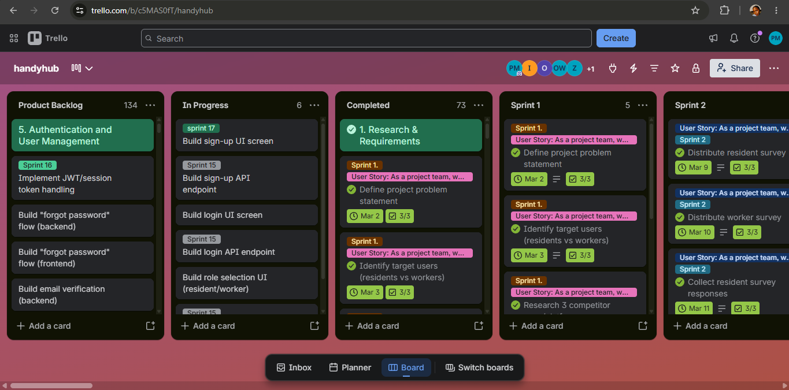
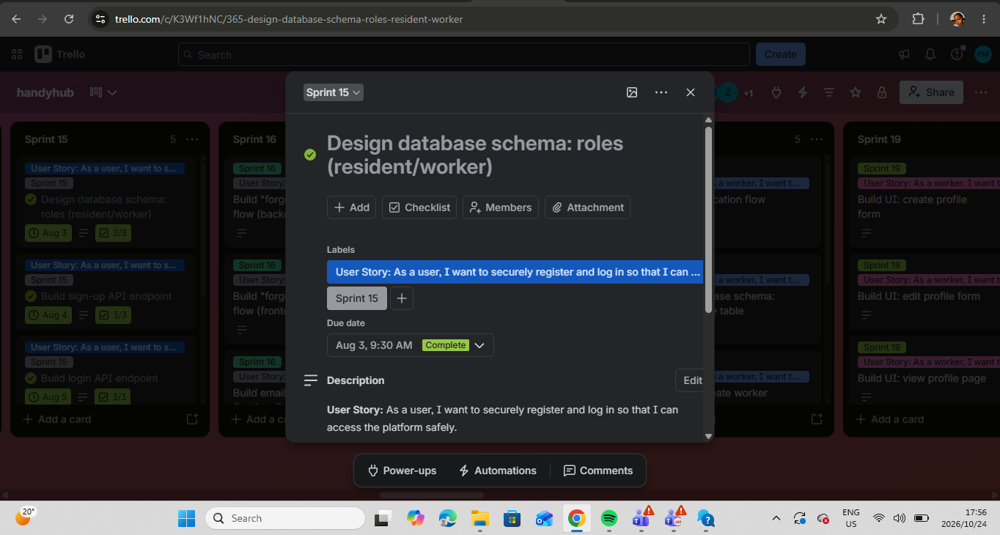
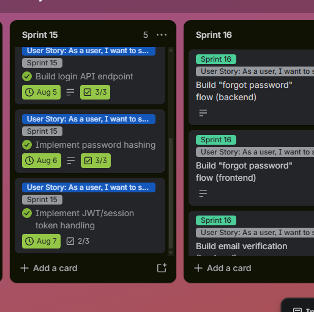
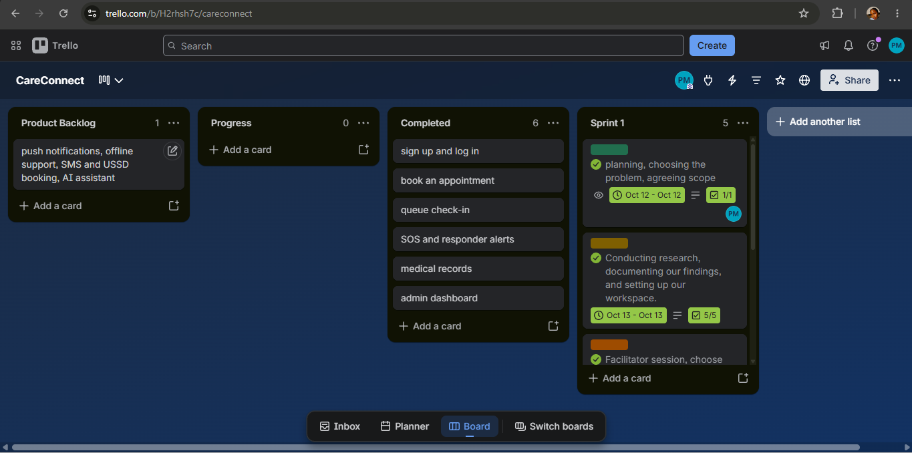
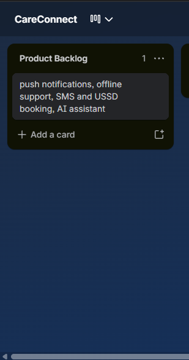
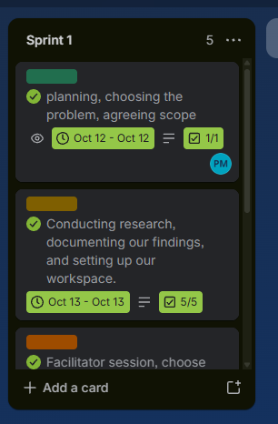

# Andile Pamela Masina Github Account

---

# Andile Pamela Masina
**Cape Town, Western Cape** | 0842192037
[LinkedIn](https://www.linkedin.com/in/andile-masina-a099ba220) | 221568816@mycput.ac.za

---

## Objective
I am an ICT student with a background in Application Development and a certified foundation in Data Analytics. Strong in frontend development using HTML and CSS, with an eye for clean, user-friendly interfaces. Comfortable working with data, basic SQL, and analytical thinking to support informed digital solutions.

---

## Projects
* **Student Enrollment App**
    * [View on GitHub](https://github.com/PamMasina/enrollment_system_app)
* **Local NGO Website**
    * [View on GitHub](https://github.com/PamMasina/Local-NGO-website)
* **Supermarket Sales Analysis**
    * [View on GitHub](https://github.com/PamMasina/Supermarket-Sales-Analysis)

---

## Experience
### Learner | Business Administration and Management
**Apex Investment Holdings** | *2021*
* Completed a structured learnership focused on business administration and management principles.
* Developed business plans and learned how to manage small businesses.
* Gained knowledge of financial concepts including budgeting and cost management.
* Built strong communication, teamwork, and problem-solving skills.

---

## Education
* **Diploma in ICT - Application Development**
    * Cape Peninsula University of Technology | *2024 – Present*
* **Higher Certificate in Information Communication Technology**
    * Cape Peninsula University of Technology | *2023*
* **Matric**
    * Thistle Grove Combined School | *2020*

---

## Skills
### Technical Skills
- [x] HTML & CSS
- [x] Basic JavaScript
- [x] Python & Basic SQL
- [x] Microsoft Excel & Data Analytics
- [x] Responsive Web Design

### Academic & Practical Skills
- UI/UX Design Principles
- Problem Solving & Debugging
- Working with Data Sets
- System Requirements Analysis

---

## References
1. **Sinethemba Mabaso** – Mentor | 068 102 2190
2. **Zama Zamisa** – Instructor | 082 648 6529

---

## Resume Link
[View CV on GitHub](https://github.com/wil-it-2026/cv-submission-PamMasina)

---

## Reflection

### Reflection on Coding in Markdown: STAR Method

**Situation**
As part of the Project Presentation 3 assessment, I was required to build a digital portfolio using Markdown on GitHub. Prior to this task, I had no experience with Markdown and had never used it in any of my previous projects or coursework.

**Task**
My responsibility was to learn Markdown from scratch and use it to structure and present my CV, projects, and reflections in a clear, professional format on GitHub.

**Action**
Since Markdown was completely new to me, I took the initiative to teach myself. I watched YouTube tutorials to understand the basics and visited several websites to learn how specific syntax works such as how to create headings, bold text, bullet points, checkboxes, and links. I practised writing and editing the README file repeatedly, testing how changes rendered on GitHub until I felt comfortable with the format.

**Result**
By the end of the process, I was able to successfully code my entire portfolio using Markdown. Although I would rate my current confidence level at about 6 out of 10, I recognise that this is a strong foundation to build on. The more I practise, the more fluent I will become. This experience taught me that self-directed learning is a skill in itself, and that being willing to search, watch, and try again is how real growth happens.

---

# Mock Interview Video

<video src="./AP_Masina_Interview Video.mp4" controls width="600"></video>

---
## Reflection
### Reflection on Mock Interview Video Experience: STAR Method

**Situation**
As part of the work readiness component of this module, I was required to record a mock interview video to demonstrate my ability to present myself professionally and respond to interview-style questions.

**Task**
I needed to film myself conducting a mock interview, answer questions confidently, and embed the video in my digital portfolio as evidence of my work readiness development.

**Action**
I prepared for the interview by reviewing interview questions in our subject guide and thinking through how to articulate my skills and experience. However, when it came time to record, I found it extremely difficult to speak naturally, even when interviewing myself. I had to push through the discomfort, re-record where necessary, and remind myself of the purpose of the exercise.

**Result**
Although it was one of the most challenging parts of this assessment, I completed the video and submitted it as required. The experience revealed to me just how important interview preparation and practice are. I realised that if I found it difficult to speak when alone, I need to put in significantly more effort before attending actual job interviews. Going forward, I intend to practise speaking out loud more regularly, record myself answering questions, and build my confidence incrementally so that I am better prepared when real opportunities arise.

---

# Andile Pamela Masina Github Pages

---

# Reflection
### 3. Reflection on the Use of GitHub Pages: STAR Method

**Situation**
The assessment required me to deploy my digital portfolio to GitHub Pages so that it would be publicly accessible via a live URL. GitHub Pages was a tool I had been introduced to during this module, and I had successfully deployed my github portfolio approximately four weeks ago as my first submission deadline.

**Task**
My task was to ensure that my portfolio was correctly deployed and live on GitHub Pages, and to submit the working link as evidence of my published portfolio.

**Action**
I followed the steps to enable GitHub Pages on my repository, selected the correct branch to deploy from, and confirmed that my portfolio was live at my GitHub Pages URL. At the time, the site was accessible and all content was displaying correctly. I also explored the GitHub Pages settings to understand how the deployment pipeline works.

**Result**
Initially, the deployment was successful and my portfolio was publicly viewable. However, on the 18th of April 2026 I encountered a 404 error on the live link, which indicated that the GitHub Pages site was no longer being served correctly. This may have been caused by a change in the repository's branch settings or the source folder configuration. This experience highlighted the importance of regularly checking deployed sites and understanding how hosting environments can be affected by changes in repository settings. I am currently troubleshooting the issue by reviewing my Pages configuration to restore the live site before the submission deadline.

---

# WIL Agile Portfolio

My WIL subject ran from July to November 2026. I did a school WIL project, **HandyHub**, in July and August, and then started my industry placement at **Capaciti** in September, where I am still working. This part of my portfolio holds the five Agile artefacts for each project. Every artefact has its evidence and a reflection.

| Contents | Artefacts |
|---|---|
| [WIL Part 1: HandyHub, School WIL Project (July to August 2026)](#handyhub) | Agile Team Charter, User Stories and Tasks, Product Backlog, Sprint Backlog, Agile Logbook |
| [WIL Part 2: CareConnect, Industry Placement at Capaciti (September to October 2026)](#careconnect) | Agile Team Charter, User Stories and Tasks, Product Backlog, Sprint Backlog, Agile Logbook |
| [Reflection on both projects](#reflection-on-both-projects) | A comparison of the two |

## WIL Part 1: HandyHub (School WIL Project, July to August 2026)

HandyHub is a community app that connects residents of Belhar with trusted local service providers such as plumbers, electricians, painters and carpenters. The project began in Term 1, in my Professional Communication subject, where we had to find a gap in our community and help to close it. From March to June we planned the solution using the brief from that subject. In July, my Project Presentation lecturer asked us to develop the app as our WIL school project, so I continued the project from July to August 2026, starting from the planning and business case we had already done. A survey of 27 Belhar residents showed that 96.3% had struggled to find a reliable service provider, and 100% said they would use an app to find verified ones.

**My role:** Product Owner and Agile Lead. I also led the development of the application and coded the landing page, sign up, login, client dashboard, service provider dashboard and profiles.

**Links:** [HandyHub app](https://handyhub-mobile.vercel.app) | [Trello board](https://trello.com/b/c5MAS0fT/handyhub)

[Back to contents](#wil-agile-portfolio)

---

### HandyHub Artefact 1: Agile Team Charter

**Evidence:** [Agile Team Charter (PDF)](Handyhub/Agile_Team_Charter.pdf)

| | |
|---|---|
| **Mission** | Solve the difficulty of finding trustworthy skilled workers in Belhar by connecting residents with verified service providers |
| **Success** | A working app where users can register, search and connect with workers, positive feedback in testing, and a completed presentation |
| **Framework** | Kanban on Trello, with daily stand-ups, weekly planning, a demo at the end of each sprint and weekly retrospectives |
| **Communication** | WhatsApp for quick messages, Microsoft Teams for meetings, email for formal matters |
| **Decisions** | Consensus or a team vote, escalating to the Product Owner if stuck |
| **Team** | Andile Pamela Masina (Product Owner and Agile Lead), Zahrah Vermaak (Developer, Analyst and Tester), Olona Williams (Developer and Designer) |

**Reflection (STAR)**

**Situation:** Our charter, written in April 2026, set out three roles: me as Product Owner and Agile Lead, Zahrah as Developer, Analyst and Tester, and Olona as Developer and Designer. At the end of July, Olona left the project because she got an industry placement. From then on, the two of us had to deliver work that had been planned for three people.

**Task:** I had to keep the project moving and make sure that the app was built and the documentation and presentation were completed, even though the plan assumed a larger team.

**Action:** We shared the work by what each of us could do. I asked Zahrah to focus on the documentation and the presentations, and I led the development of the application. The workload was too much for two people, so we could not follow the sprint plan we had written on Trello. Dividing the work this way was how we made it manageable.

**Result:** The app was built and the project was presented. I learned that a charter is only a starting point, and that it must be updated when the team or the workload changes. Having to be both Product Owner and Agile Lead while also leading the development of the app showed me how much a small team depends on clear roles. Next time I would revise the charter and the sprint plan as soon as the team became smaller, instead of working around them.

[Back to contents](#wil-agile-portfolio)

---

### HandyHub Artefact 2: User Stories and Tasks

**Evidence:** [Trello board](https://trello.com/b/c5MAS0fT/handyhub) | [Taskboard and logbook, 14 to 17 July](Handyhub/Logbook_14-17_July_2026.docx)

We wrote eight user stories, each broken into tasks and planned across sprints on Trello. This table shows the stories and what happened to each one in the finished app.

| # | User story | Main tasks | Result in the app |
|---|---|---|---|
| 1 | Conduct research and define the project requirements | Identify the problem, run the resident survey, analyse the results, complete the business case, gather requirements, create the product backlog | Done. The survey of 27 residents and the business case were completed |
| 2 | Plan and design the application | Present the business idea, create UI wireframes, design the navigation flow and database, allocate development tasks | Done. Wireframes were designed in Figma and the app followed them |
| 3 | Allow users to register and log in | Design the registration and login pages, implement authentication, test registration, fix bugs | Working. Sign up, log in, role selection, password reset |
| 4 | Allow workers to advertise their services | Create a worker profile, add skills and qualifications, upload previous work | Working. Worker profiles can be viewed and edited. Photo upload of previous work is not implemented |
| 5 | Allow residents to find service providers | Search by service category and location, view worker profiles | Working. Residents browse categories and open worker profiles. The workers shown on the Home tab are demo data |
| 6 | Allow residents to request services | Create the request feature, accept or decline requests, notifications, test the booking workflow | Working. Residents send requests, workers accept them, with live chat and notifications |
| 7 | Build trust between users | Ratings, reviews, worker verification | Not developed. Ratings shown in the app are demo data |
| 8 | Test and deploy the application | System testing, bug fixing, final testing, deployment | Done. The app was tested and deployed on Vercel at [handyhub-mobile.vercel.app](https://handyhub-mobile.vercel.app) |

**Screens in the finished app:** onboarding, role selection, sign up, confirm code, log in, forgot and reset password, Home, Categories, service list, worker profile, request a job, Jobs, Messages, new chat, chat, notifications, Profile, personal information, privacy and security, settings, payment methods and saved addresses (the last two are placeholders).

**Reflection (STAR)**

**Situation:** Our user stories gave us a clear plan for the app, from registration through to deployment. The first big decision I had to make was which technology to build it with.

**Task:** I had to choose a tech stack that I could work with in the time available, while also doing the Product Owner and Agile Lead work. I was at home and had time to work, but I also had a lot of other work and could not afford to learn a completely new language or framework.

**Action:** I chose the technologies I was already comfortable with. The only new thing I learned was Supabase. I researched options and found a cloud service that provides a database, SQL, authentication and security in one place, which suited a small team. I then coded the landing page, sign up, login, client dashboard, service provider dashboard and profiles. For a while I worked at a steady pace, but my lecturer then said that the app had to be complete and deployed. I did not have enough time left to finish the chat system myself, so I got help to complete it.

**Result:** Stories 1 to 6 were working in the finished app, and the app was tested and deployed (story 8). Story 7, building trust through ratings and reviews, was not developed, because there was not enough time for a team of two. I learned that choosing tools is a project decision, not only a technical one, and that the right choice balances what you already know with what you can learn in time. I also learned to decide early which parts to do myself and which to get help with when a deadline moves. Next time I would estimate the size of each story at the start and begin the largest ones, like the chat, earlier.

[Back to contents](#wil-agile-portfolio)

---

### HandyHub Artefact 3: Product Backlog

**Evidence:** [Trello board, Product Backlog list](https://trello.com/b/c5MAS0fT/handyhub)

Our product backlog lives in the Product Backlog list on Trello. It holds all the work for the project, grouped into epics such as "1. Research and Requirements" and "5. Authentication and User Management". Each card carries a sprint label, and finished cards move to the Completed list. The requirements in the Term 1 brief were the starting point for the backlog. At the time of my screenshot on 24 October 2026, the board showed 134 cards in the Product Backlog list, 6 in In Progress and 73 in Completed. One of our Sprint 4 tasks was to prioritise the user stories using the MoSCoW method.

**Reflection (STAR)**

**Situation:** The requirements for HandyHub came from the Term 1 brief in Professional Communication, from March to June. When my Project Presentation lecturer asked us in July to develop the app, we had to start from that planning and turn it into a backlog we could build from.

**Task:** I had to turn all the requirements into a prioritised, organised backlog that a team of two could deliver, as the Product Owner.

**Action:** I treated everything in the brief as a requirement and organised it into epics, cards and sprints on Trello, with a checklist on each card. When Olona left at the end of July and the team became two, we did not remove anything from the backlog. Instead we divided the work, with Zahrah doing the documentation and me working on the app.

**Result:** The backlog gave us a clear picture of the whole project, and 73 cards were completed. A large part of it, 134 cards, was still open at the end, which showed me that we kept more in the backlog than a team of two could finish. I learned that a backlog is a living list, and that when the team's capacity changes, the Product Owner should re-prioritise and move lower-priority items out, instead of leaving them all in. Next time I would do that as soon as the team changed.

[Back to contents](#wil-agile-portfolio)

---

### HandyHub Artefact 4: Sprint Backlog

**Evidence:** [Trello board, Sprint 15 list](https://trello.com/b/c5MAS0fT/handyhub)

**Sprint 15, 3 to 7 August 2026.** This was our first sprint of real development work, and the last full sprint before my 4 to 7 August logbook. The sprint backlog is the Sprint 15 list on Trello.

**Sprint goal:** Build the foundation for registration and login (database design, sign-up, login, password hashing and session handling), so that users can securely register and log in and access the platform safely. This sprint belongs to the Authentication and User Management epic.

| Card | Due | Subtasks | Status |
|---|---|---|---|
| Design database schema: roles (resident/worker) | 3 August | List the fields needed, draft the table structure, test the schema with sample data | Complete (3 of 3) |
| Build sign-up API endpoint | 4 August | 3 subtasks | Complete (3 of 3) |
| Build login API endpoint | 5 August | 3 subtasks | Complete (3 of 3) |
| Implement password hashing | 6 August | 3 subtasks | Complete (3 of 3) |
| Implement JWT/session token handling | 7 August | 3 subtasks | Marked complete, 2 of 3 subtasks ticked |

Each card carries the user story *"As a user, I want to securely register and log in so that I can access the platform safely"* and a checklist of three subtasks. The subtasks on the cards still carry the names from our original plan (Andile, Olona and Zahrah). After Olona left, the development work in this sprint was done by me.

**Reflection (STAR)**

**Situation:** In the week of 3 August we started the first real development sprint. The team was now two people, and the sprint plan had been written when we were three.

**Task:** As Product Owner and development lead, I had to choose work for the sprint that one developer could finish in a few days, and that the rest of the app depended on.

**Action:** I kept the sprint small and focused on one user story: registering and logging in. I picked the database design for roles, the sign-up and login endpoints, password hashing and session token handling, with one card due each day from 3 to 7 August, and a checklist of three subtasks on each card. I did the development work myself, while Zahrah continued with the documentation and presentations.

**Result:** Four of the five cards were completed with every subtask ticked, and the fifth, JWT and session token handling, had two of its three subtasks done by the end of the sprint. A small sprint with a single clear goal was much easier to finish than the long sprint plan we had written earlier. I also learned that the names on the card subtasks should have been updated when Olona left, because the board no longer showed who really did the work. Next time I would update owners and subtasks as soon as the team changes, so that the Sprint Backlog reflects reality.

[Back to contents](#wil-agile-portfolio)

---

### HandyHub Artefact 5: Agile Logbook

**Evidence (my weekly logbooks, as I submitted them):**
[14 to 17 July](Handyhub/Logbook_14-17_July_2026.docx) | [21 to 24 July](Handyhub/Logbook_21-24_July_2026.docx) | [28 to 31 July](Handyhub/Logbook_28-31_July_2026.docx) | [4 to 7 August](Handyhub/LogBook_4%20-%207%20August%202026.docx)

I kept a weekly logbook for the WIL project, using the template with three parts: a Taskboard, a Walkthrough with four team questions, and a daily stand-up log that answers three questions each day (what I completed, what I plan next, and what is blocking me). Each logbook was submitted every week.

| Week | What the logbook records |
|---|---|
| 14 to 17 July | First online entrepreneurship meeting. Prepared our business case and presented it to the class on 16 July. On 17 July the group planned the next steps and how to divide tasks |
| 21 to 24 July | Prepared and presented our product backlog, user stories and sprints to the class on 23 July. Planned the UI and UX design |
| 28 to 31 July | Presented our wireframes, designed in Figma, on 28 July and attended other group presentations. There are no entries for 30 and 31 July because of a strike on campus, so we did not work on those days |
| 4 to 7 August | Presented our frontend app on 4 August. Reviewed the sprints and brand guide, then fixed the frontend app and reviewed the product backlog on 7 August |

The blockers that appear most often were coordinating meeting times for the group, making sure everyone contributed equally, limited time before presentations, and, later, limited time to code the whole app.

**Reflection (STAR)**

**Situation:** Each week I had to record my daily stand-ups in the logbook, while attending the entrepreneurship meetings, presenting with my group, and starting to develop the app.

**Task:** I had to keep an honest daily record of what I completed, what I planned and what was blocking me, for four weeks from 14 July to 7 August.

**Action:** I filled in the logbook each week using the three stand-up questions. The entries follow the work from the business case, to the product backlog and user stories, to the wireframes, and then to the frontend app. On 30 and 31 July I did not write entries, because a strike on campus meant that we did not work on those days.

**Result:** The logbook gave me a clear record of how the project moved from planning to a working frontend. Writing down my blockers each day made problems such as meeting times and limited coding time visible, and that helped me plan the next step. I found it hard to keep up with it on busy days, because I also had other school subjects to attend to. I learned that a logbook only works if it is updated every day, and that short honest entries are more useful than long ones written later. Next time I would set a fixed time each day to fill it in.

## WIL Part 2: Industry Placement at Capaciti (September to October 2026)

From September, I joined the Capaciti Data Academy AI Bootcamp as my industry placement, and I am still there. The bootcamp runs weekly, project-based sprints: a chatbot, a content generator, a sentiment analysis tool and, in Week 4, an end-to-end AI solution for an industry of our choice. I chose **CareConnect**, our Week 4 group project, as my main example for this portfolio because it was our final project and the one we presented to the facilitators and the cohort.

CareConnect is a mobile-first web app for a Cape Town community clinic. Patients can book appointments, join a queue and send a one-tap SOS to first responders, while doctors, nurses, first responders and admins each see their own screens.

**Sprint 1:** 12 to 16 October 2026. We were first told to finish and present on Friday 16 October, and the presentation was then moved to Monday 19 October 2026.
**My role:** Frontend Developer. I built the app, set up Supabase and deployed it to Vercel.
**Links:** [CareConnect app](https://care-connect-delta-puce.vercel.app) | [Code on GitHub](https://github.com/PamMasina/CareConnect) | [Trello board](https://trello.com/b/H2rhsh7c/careconnect)

I set up the CareConnect Trello board after the sprint to document the work, using my notes and my GitHub commits. Our team planned and discussed face to face during the sprint.

| Team member | Role |
|---|---|
| Andile Pamela Masina | Frontend Developer |
| Nuyra Swanson | Researcher |
| Olwethu Tshing | Backend Developer |
| Siphelele Zono | Project Manager |
| Sinalo Kebetwana | Database Developer |

I built the app myself, and the commits on GitHub are mine. Siphelele shared the written documentation and Nuyra shared the PowerPoint slides on Microsoft Teams, and Olwethu tried building the app on his side too, so that we could compare.

[Back to contents](#wil-agile-portfolio)

---

### CareConnect Artefact 1: Agile Team Charter

**Evidence:** [Agile Team Charter (PDF)](Careconnect/Agile_Team_Charter_CareConnect.pdf)

| | |
|---|---|
| **Mission** | Build a secure, easy-to-use app that shortens waiting at community clinics, makes booking clear, and gets help to people in an emergency faster |
| **Success** | A working, deployed app with booking, a queue, a one-tap SOS, role-based access and protected patient data, presented at the end of the sprint |
| **Framework** | Kanban on Trello, with one sprint from 12 to 16 October and a presentation to the facilitators |
| **Communication** | Face-to-face group discussions, Microsoft Teams for sharing documents and slides, GitHub for code |
| **Decisions** | Consensus, then our facilitator if we are stuck |
| **Definition of done** | Features work correctly, are committed to GitHub, work on the deployed Vercel version and are ready to demonstrate |
| **Main risks** | Securing patient data with role-based access, keeping the queue and SOS up to date across users, and a very short time |

**Reflection (STAR)**

**Situation:** We were a new group of five on a one-week project. We met on 12 October to plan, choose the problem and agree the scope, and again on 14 October, after our facilitator explained the brief, to decide on the health system and who would do what.

**Task:** We had to agree on a purpose, roles and ways of working quickly, so that we could use the rest of the week to build and present.

**Action:** We wrote the charter around a shared mission and a clear list of roles, with me as Frontend Developer, Nuyra as Researcher, Olwethu as Backend Developer, Siphelele as Project Manager and Sinalo as Database Developer. We agreed to communicate face to face and to share documents on Microsoft Teams.

**Result:** The charter gave us a shared goal, but in practice the work was not split the way the roles suggested. I built the app alone, while others shared documentation and slides on Teams and one member tried building the app separately for comparison. I was not always sure what everyone else was working on. I learned that a list of roles is not enough, and that a team also needs a short, regular update on who is doing what. Next time I would ask every member to post a daily update, so that the work is visible and shared more evenly.

[Back to contents](#wil-agile-portfolio)

---

### CareConnect Artefact 2: User Stories and Tasks

**Evidence:** [Trello board](https://trello.com/b/H2rhsh7c/careconnect)

We wrote user stories for each role in the app: patient, doctor or nurse, first responder and admin.

| ID | User story | Main tasks | Result at the presentation |
|---|---|---|---|
| US-01 | As a user, I want to sign up and log in with my role, so that I see the right features | Sign up and log in screens, role selection, password reset | Working |
| US-02 | As a patient, I want to book an appointment at a clinic, so that I do not have to phone around | Clinics list, booking screen | Working |
| US-03 | As a patient, I want to see and cancel my appointments, so that I can manage my care | My appointments screen | Working |
| US-04 | As a patient, I want to check in to the queue and see my place, so that I know how long I will wait | Queue status screen | Working |
| US-05 | As a patient, I want to send an SOS with one tap, so that help knows where I am | SOS screen, location, nearest clinic | Working |
| US-06 | As a patient, I want to see my medical record, so that I know what the clinic has on file | Medical record screen | Working |
| US-07 | As a doctor or nurse, I want to manage the queue, so that patients are seen in order | Queue management screen | Working |
| US-08 | As a doctor or nurse, I want to see my appointments, so that I can prepare | Doctor and nurse dashboards, staff appointments | Working |
| US-09 | As a doctor or nurse, I want to update a patient's record, so that the next person has current information | Patient record editor | Working |
| US-10 | As a first responder, I want to receive SOS alerts and update them, so that I can reach people fast | Responder inbox | Working |
| US-11 | As an admin, I want to manage staff and roles, so that the right people have access | Admin dashboard, users | Working |
| US-12 | As an admin, I want to manage services and clinic details, so that patients see accurate options | Admin dashboard, services | Working |
| US-13 | As a user, I want to install the app on my phone, so that I can open it like any other app | PWA setup | Working |
| US-14 | As a patient, I want my data protected, so that only the right people can see it | Access rules for each role | Working |

Four more stories were left for the future: push notifications and SMS, offline support, SMS and USSD booking, and an AI health assistant.

**Reflection (STAR)**

**Situation:** Our facilitator gave us the brief on 14 October, and we had to turn it into a working app in a few days.

**Task:** I had to turn each user story into a working screen, and starting was the hardest part for me.

**Action:** I wrote the stories by role, so that each person who uses the app had their own set. I then started the app on 14 October with the Supabase setup and the clinics flow, and I added the other screens one story at a time.

**Result:** Working through the stories one at a time gave me a clear order to build in, and by the presentation each role had its own screens. I learned that stories written by role make it easier to see what to build next, and that I should have broken the biggest stories, like the SOS and the role-based access, into smaller tasks earlier.

[Back to contents](#wil-agile-portfolio)

---

### CareConnect Artefact 3: Product Backlog

**Evidence:** [Trello board, Product Backlog list](https://trello.com/b/H2rhsh7c/careconnect)

The product backlog lists all of the work we planned for CareConnect, in priority order. Safety and privacy came first: access rules, sign up, the SOS and the responder screen. Then came the patient journey of booking and queue, then staff and admin tools, and last the improvements. The future ideas stayed at the bottom of the list.

| Priority | Items | Status |
|---|---|---|
| 1. Must | Supabase setup, role-based access, sign up and log in, SOS and responder alerts | Done at the presentation |
| 2. Must | Book an appointment, queue check-in, staff queue, admin staff management, deployment | Done at the presentation |
| 3. Should | My appointments, medical records, staff schedule, record editing, admin services, PWA install | Done at the presentation |
| 4. Could | Push notifications, SMS fallback, offline support, assisted booking points, SMS and USSD booking, multilingual support, native low-data app, AI health assistant | Future |

**Reflection (STAR)**

**Situation:** With only a few days, we could not build everything we imagined, so we needed an order.

**Task:** I had to decide what the app needed first, and what could wait.

**Action:** I put anything that affected safety, such as the SOS and who can see patient data, at the top, followed by the booking and queue that patients use most. The ideas that needed more time or other services, like SMS booking and the AI assistant, went to the bottom as future work.

**Result:** We presented a working app with all of the main journeys, and a clear list of what would come next. I learned that a backlog is an order of decisions, not just a list. Putting "Could" items at the bottom stopped them from taking time away from the "Must" items.

[Back to contents](#wil-agile-portfolio)

---

### CareConnect Artefact 4: Sprint Backlog

**Evidence:** [Trello board, Sprint 1 list](https://trello.com/b/H2rhsh7c/careconnect)

**Sprint 1, 12 to 16 October 2026.**
**Sprint goal:** Choose the problem, research and plan the solution, and build the first working version of CareConnect.

| Date | Sprint backlog item | Status |
|---|---|---|
| 12 October | Planning, choosing the problem and agreeing the scope | Complete |
| 13 October | Conducting research, documenting our findings and setting up our workspace | Complete (5 of 5 subtasks) |
| 14 October | Facilitator session on the brief. Group meeting to finalise the health system and who does what. Start the app: Supabase setup, clinics flow and the brand colours | Complete |
| 15 October | Update the interface to the Figma prototype and add the missing screens. Responsive layout and Supabase fixes. Save profile details | Complete |
| 16 October | Role selection at sign up and a dashboard for each role. Staff number for staff accounts. Clean up the layout | Complete |

**Reflection (STAR)**

**Situation:** Our facilitator first told us that the app had to be finished and presented on Friday, and I felt anxious about being rushed. Later he moved the presentation to Monday 19 October, and I relaxed because I knew I would have the time to complete the app.

**Task:** I had to plan one sprint of daily work that moved us from choosing a problem to a working app, while carrying most of the building myself.

**Action:** I planned the sprint day by day. The first two days were for planning and research, then I started the app on 14 October, brought it in line with our Figma designs on 15 October, and built the role selection and role dashboards on 16 October. I worked on the largest and most important parts first.

**Result:** By the end of the sprint the app had sign up, role-based dashboards and the clinics flow, and we presented the finished app on Monday 19 October. I learned that starting is the hardest part, and that pressure from a short deadline is easier to manage when the work is planned in small daily steps. Next time I would split the work across the whole team from day one.

[Back to contents](#wil-agile-portfolio)

---

### CareConnect Artefact 5: Agile Logbook

**Evidence:** [Agile Logbook for CareConnect](Careconnect/Agile_Logbook_CareConnect.pdf)

I wrote the CareConnect logbook up after the sprint, using my Trello cards and my GitHub commit history, as the entries below show. It follows the same template as my HandyHub logbooks, with three stand-up questions for each day.

| Date | What I completed | What I planned next | Blockers |
|---|---|---|---|
| Mon 12 Oct | Planned with the group, chose the problem and agreed the scope | Research the problem and set up our workspace | None recorded |
| Tue 13 Oct | Researched the problem, documented our findings and set up our workspace | Attend the facilitator session and finalise our choices | None recorded |
| Wed 14 Oct | Attended the facilitator session on the brief. Met my group to finalise the health system and who does what. Started the app with Supabase, the clinics flow and the brand colours, and applied the Figma-inspired interface | Match the interface to the Figma prototype and add the missing screens | Starting the app, and time pressure, because we had been told to present on Friday |
| Thu 15 Oct | Updated the interface to the Figma prototype and added the missing screens. Made the layout responsive, fixed Supabase issues and saved profile details | Add role selection at sign up and a dashboard for each role | Time pressure. I could not see what the other members were working on |
| Fri 16 Oct | Added role selection at sign up and routed each role to its own dashboard. Added a staff number for staff accounts. Cleaned up the layout | Continue building and designing the app, and prepare to present | Time pressure |
| Mon 19 Oct | Presented CareConnect to the facilitators with a live demo and a QR code to the deployed app | Reflect on the project | None |

**Reflection (STAR)**

**Situation:** For CareConnect I did not keep the logbook day by day. I wrote it afterwards from my Trello cards and my GitHub commits.

**Task:** I had to give an honest record of a week of work, for a project where the days moved fast.

**Action:** I used the dated commits and the Trello cards as the source for each entry, and I kept the blockers I had really felt: starting, time pressure and not seeing what others were doing.

**Result:** The commit history made the record accurate, but writing it afterwards was harder than keeping it daily, as I did for HandyHub. I learned that a logbook is most useful when it is written as the work happens, because it makes blockers visible while they can still be fixed. Next time I would write the three stand-up answers at the end of every day.

[Back to contents](#wil-agile-portfolio)

---

## Reflection on Both Projects (STAR)

**Situation:** In my WIL subject I worked on two team projects in two very different settings: HandyHub, a school project that began in an earlier subject and carried on from July to August, and CareConnect, a one-week sprint during my industry placement at Capaciti.

**Task:** I had to use Agile practices in both, from a team charter to a logbook, and to show what I learned from each.

**Action:** For both projects I wrote a charter, user stories, a product backlog, a sprint backlog and a logbook, and I kept a Trello board. HandyHub gave me a long project with many sprints and weekly logbooks, and a team that shrank from three to two when Olona left. CareConnect gave me a short project with five people, a fixed deadline set by our facilitator and a very short sprint.

**Result:** In both projects the plan on paper did not match how the work really happened. On HandyHub we could not follow our Trello sprint plan, so we divided the work, with Zahrah on the documentation and presentation and me leading the development. On CareConnect I built the app, while the others shared documentation and slides on Teams and one tried building the app separately for comparison. I learned that:

- a charter and a sprint plan must be updated when the team or the workload changes
- a small sprint with one clear goal, like Sprint 15 on HandyHub, is easier to finish than a long plan
- a logbook works best when it is written every day, as I did on HandyHub, and not afterwards, as on CareConnect
- a team needs a short, regular update on who is doing what, so that the work is visible and shared more evenly
- choosing tools is a project decision, and I should balance what I know with what I can learn in the time

The biggest difference was pace. HandyHub taught me to plan across many weeks, and CareConnect taught me to deliver under a tight deadline. Next time I would bring both lessons together: plan small sprints, update the plan when the team changes, and ask for daily updates from everyone.
